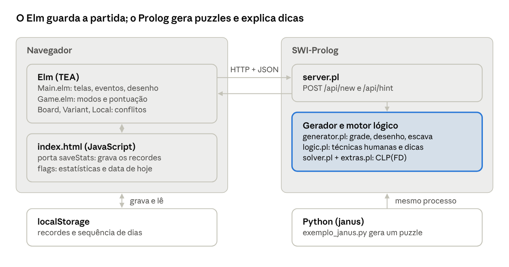

# Super Sudoku (versão final) — explicação dos tópicos

9 de novembro de 2026 · versão online (editável): https://claude.ai/artifact/RgZXYg9ee7SKne3Ef16mzu

## Visão geral

A versão final é o projeto do membro (`Super_Sudoku-claude-sudoku-ai-complexity`) com as regras e os extras da versão que eu tinha feito em paralelo. Está em `D:\Super_Sudoku_final`; a pasta original no disco C não foi alterada.

O projeto do membro já tinha a parte mais sofisticada: um **motor lógico "humano"** em Prolog, que resolve como uma pessoa (candidato único, interseção, X-Wing...), classifica a dificuldade pela técnica mais difícil necessária e explica cada dica em português. Tinha também modos de jogo, pontuação com combos e desafio diário em Elm.

### O que foi acrescentado

| Acréscimo | Onde |
| --- | --- |
| 11 regras novas (16 no total): anti-rei, disjunto, não-consecutivo, termômetros, setas, kropki, X e V, sussurro, renban, palíndromo, entre-pontas | `geometry.pl`, `extras.pl` (novo), `solver.pl`; `Variant.elm`, `Local.elm` (novo) |
| Gerador desenha as regras locais a partir da solução (gerar e testar) | `extras.pl` (`make_extras/3`), `generator.pl` |
| Técnica "Regra local" no motor lógico, com explicação | `logic.pl` (`step_for(local_rule, ...)`) |
| Grade do "Milagre" como modelo para combinações com não-consecutivo | `templates.pl` |
| Meta-interpretador que conta as restrições; o total aparece na tela | `meta.pl` (novo), `server.pl`, `Main.elm` |
| Desenho das regras locais em SVG com `Svg.Lazy` | `Overlay.elm` (novo), `style.css` |
| Conflitos e auto-notas respeitando as regras novas | `Board.elm` |
| Prolog chamado do Python (janus) | `backend/python/exemplo_janus.py` (novo) |
| Correção: arquivo inexistente (favicon) dava erro 500, agora 404 | `server.pl` |
| 8 testes novos (+12 subtestes) | `backend/tests/test_sudoku.pl` |

### Arquitetura

O Elm guarda o estado da partida e confere cada jogada sozinho; o Prolog gera os puzzles e dá as dicas. O servidor não guarda estado: a cada pedido de dica o Elm reenvia regras, gaiolas, paridade, regras locais, tabuleiro e solução.



### Como rodar

```
cd D:\Super_Sudoku_final
swipl backend/server.pl 8080                       # abra http://localhost:8080
swipl -g run_tests -t halt backend/tests/test_sudoku.pl   # 27 testes
make run                                            # recompila o Elm e sobe o servidor
python backend/python/exemplo_janus.py              # precisa de pip install janus-swi
```

O `frontend/public/elm.js` já vai compilado, então só é preciso o Elm (0.19.1, como no `elm.json` do membro) para mudar o código Elm.

### Como foi verificado

- Os 27 testes plunit passam (os 19 originais e os 8 novos), incluindo a solidez do motor lógico com as regras novas: toda eliminação e colocação bate com a solução.
- Puzzles gerados com cada regra nova têm solução única, provada com CLP(FD).
- O código Elm rodou em Node.js contra puzzles do servidor: a solução tem zero conflitos, trocar qualquer uma das 81 células é detectado, e as auto-notas sempre incluem o dígito certo.
- O site foi aberto num navegador automático: gerar com 9 regras ligadas, pedir dica (veio uma dica "Regra local" explicando o palíndromo), sem erros no console.

## Mapa: tópico do cronograma → onde está no código

Quase todos os tópicos do `CRONOGRAMA.rst` aparecem no código final. Ficaram de fora lentes, Elm SPA/Elm Land e Vite/Tailwind; a seção de Elm diz onde caberiam.

| Aula | Tópico | Onde está |
| --- | --- | --- |
| 14/08 | Sintaxe, átomos, variáveis, fatos, regras, consultas | `geometry.pl` (`known_rule/1`, `house/2`), `logic.pl` (`technique/3`) |
| 19/08 | Termos, operadores, homoiconicidade, unificação, aridade | `VT =.. [v\|Vars]` em `solver.pl`; `ctx/6`; `I-D` e `L-C` como dados; palíndromo por unificação em `extras.pl` |
| 21/08 | Aritmética, `is` vs CLP(FD) | `extras.pl` (`#=`, `chain/2`, `#\/`) contra `generator.pl` e `invent/4` (`is`, `=:=`) |
| 26/08 | Listas, cabeça e cauda, recursão | `whisper/1`, `renban/2`, `extend/5`, `assign/4`, `comb/3`, `set_nth0/4` |
| 28/08 | N-rainhas, estratégias de labeling, Prolog no Python | anti-cavalo/anti-rei; `labeling([ff], …)`; `random_label/1`; reinícios em `restart_search/4`; `exemplo_janus.py` |
| 02/09 | Sudoku em Prolog, variantes, problemas novos | `post_constraints/2`, `extras.pl`, `generator.pl` |
| 04/09 | Decisão, P vs NP, NP-completo | `count_solutions/4` com `limit/2`, `unique_solution/2` com tempo máximo, técnicas como prova de unicidade |
| 09/09 | Backtracking, negação, disjunção, corte | `member/2` em `random_label/1`, `\+` em todo o motor, `->`, `!` em `find_step/5` |
| 11/09 | Lógica cláusal | leitura lógica das cláusulas de `step_for/5` |
| 16/09 | Meta-interpretadores | `meta.pl` |
| — | Integração com outras linguagens | `server.pl` (HTTP/JSON), janus |
| 02/10 | Funções puras, imutabilidade, ordem superior | `Board.elm`, `Game.elm` (desfazer com `past`/`future`), `Local.violations` |
| 07/10 | Sintaxe Elm, TEA | `Main.elm` |
| 09/10 | Tipos algébricos | `Rule`, `Local.Kind`, `Screen`, `HintState`, `Status`, `Mode` |
| 14/10 | Maybe, Result, case | `Api.Error`, `GotPuzzle (Result …)`, `Maybe.andThen` em `Main.elm` e `Board.elm` |
| 21/10 | Currying, composição, point-free | `E.string << Variant.ruleId`, `HttpError << Http.BadBody << D.errorToString`, `andMap = D.map2 (\|>)` |
| 23/10 | Encoders, decoders, HTTP | `Api.elm`, `Local.elm` |
| 30/10 | Ports e efeitos | porta `saveStats` + flags em `index.html` |
| 04/11 | Encapsulamento, estados inválidos, validação vs parsing | `Local.Kind`, decoders, `parse_extra/2` no servidor |
| 06/11 | Lab parte 2: servidor, validação, novos problemas, persistência | `/api/new`, `/api/hint`, recordes no localStorage |
| 11/11 | DOM virtual | `Svg.Lazy.lazy Overlay.view` |
| 13/11 | Elm em produção | `Makefile` (`elm make --optimize`), servidor serve os arquivos estáticos |

## Prolog 1: sintaxe, termos, unificação, CLP(FD) e listas

### Fatos, regras, consultas e módulos

O backend é dividido em **módulos** (`:- module(geometry, [cell_rc/3, houses/2, ...])`): cada arquivo exporta só alguns predicados, como uma interface. Dentro deles há fatos e regras:

```prolog
known_rule(diagonal).                              % fato
technique(naked_single, 1, 'Candidato único').     % fato de aridade 3

cell_rc(I, R, C) :-                                % regra
    R is I // 9,
    C is I mod 9.
```

As casas (linhas, colunas, blocos, diagonais, janelas, grupos disjuntos) são cláusulas de `house/2`. Cada cláusula descreve um tipo de casa e o backtracking gera todas: `houses(Rules, Hs) :- findall(H, house(Rules, H), Hs).` Acrescentar a regra disjunto foi só mais uma cláusula de `house/2`. Uma consulta como `?- technique(T, 3, Nome).` lista as técnicas de nível 3, uma por vez.

### Termos como estruturas de dados

O projeto usa termos compostos como registros:

- `ctx(Regras, Casas, Gaiolas, Paridade, Extras, Vizinhos)` — o contexto da partida.
- `step(Tecnica, Foco, Regiao, Eliminacoes, Colocacao, Mensagem)` — um passo de dica.
- `extra(thermo, [3, 4, 5], none)` — uma regra local.
- `I-D` — "célula I, dígito D". O `-` é só o operador `op(200, yfx, -)` usado como par ordenado; `write_canonical(12-7)` mostra `-(12,7)`.

### Homoiconicidade: `=..` e `arg/3`

```prolog
VT =.. [v|Vars],        % lista de 81 variáveis -> termo v(V0, V1, ..., V80)
arg(A, VT, V)           % acesso direto à célula A-1, sem percorrer lista
```

O "univ" (`=..`) transforma lista em termo e vice-versa. O membro usou isso para ter um "vetor" de acesso direto (`solver.pl`, `logic.pl`). O meta-interpretador usa o mesmo `=..` para montar chamadas de predicados a partir de dados.

### Unificação: o palíndromo sem restrição nenhuma

A unificação casa padrões nas cabeças (`step_for(naked_single, Ctx, st(_, CT), _, step(...))`) e faz trabalho de verdade. Em `extras.pl`:

```prolog
post_extra_vars(palindrome, _, Vs) :-
    reverse(Vs, Vs).
```

Uma lista igual ao próprio reverso só unifica se a 1ª variável for a última, a 2ª a penúltima... As células viram a **mesma variável**. O teste `palindrome_is_only_unification` confere que essa regra não acrescenta nenhuma restrição ao modelo.

### `is` contra CLP(FD)

| | Aritmética primitiva | CLP(FD) |
| --- | --- | --- |
| Exemplo | `Sum is DA + DB` | `A + B #= Sum` |
| Precisa | valores já conhecidos | nada: aceita incógnitas |
| Com variável livre | erro | vira restrição e propaga |
| No projeto | `geometry.pl`, `generator.pl`, `invent/4` | `solver.pl`, `extras.pl` |

O gerador olha uma grade pronta, então usa `is` e `=:=`. O modelo do resolvedor trabalha com incógnitas, então usa CLP(FD): `all_distinct/1` nas casas, `sum/3` nas gaiolas e setas, `chain(Vs, #<)` nos termômetros, `V in 1\/3\/5\/7\/9` nas células ímpares e `A #= 2*B #\/ B #= 2*A` no ponto preto (um "ou" **reificado**, que não cria ponto de escolha).

### Listas e recursão

```prolog
whisper([]).
whisper([_]).
whisper([A, B|Rest]) :-          % cabeça com dois elementos + cauda
    abs(A - B) #>= 5,
    whisper([B|Rest]).
```

Outros exemplos: `comb/3` (todas as combinações de K elementos, usada nos pares e trios nus), `assign/4` (enumera somas possíveis de uma gaiola cortando cedo o que não cabe), `set_nth0/4` (troca o N-ésimo elemento), `renban/2` e `extend/5` (caminho aleatório).

**Armadilha encontrada na integração:** um `exclude([I]>>memberchk(I, Forbidden), All, Free)` funcionava no terminal e falhava no código compilado. Na lambda `yall`, a variável `Forbidden` era tratada como local e copiada, então o `memberchk` sempre dava certo. A correção foi um predicado auxiliar `in_list/2`. Bom exemplo para explicar escopo de variáveis em Prolog.

## Prolog 2: modelo, busca, gerador, corte e negação

### O modelo: `post_constraints/2` em `solver.pl`

```prolog
post_constraints(Ctx, Vars) :-
    Ctx = ctx(Rules, Houses, Cages, Parity, Extras, _),
    length(Vars, 81),
    Vars ins 1..9,
    VT =.. [v|Vars],
    maplist(house_constraint(VT), Houses),        % all_distinct por casa
    ( memberchk(antiknight, Rules) -> knight_pairs(KP), maplist(diff_constraint(VT), KP) ; true ),
    ( memberchk(antiking, Rules)   -> king_pairs(KG),   maplist(diff_constraint(VT), KG) ; true ),
    maplist(cage_constraint(VT), Cages),          % all_distinct + sum
    maplist(parity_constraint_at(VT), Is, Parity),
    maplist(post_extra(VT), Extras).              % regras locais
```

O mesmo modelo serve para gerar grades, contar soluções e resolver. As pistas são unificadas **antes** de postar as restrições (comentário do membro em `givens/2`): propagar sobre valores já fixos é mais barato. Não-consecutivo não tem caso especial: `build_context/5` transforma cada par de vizinhas em `extra(nonconsecutive, [I, J], none)`, e ele é tratado como qualquer regra local.

### Busca: labeling, first fail e uma estratégia própria

`solve/3` e `count_solutions/4` usam `labeling([ff], Vs)`: **first fail**, a célula com menos candidatos primeiro (a mesma opção que acelerou as N-rainhas na aula). Para sortear grades, `labeling` não serve (tenta valores sempre em ordem crescente), então o membro escreveu a própria busca:

```prolog
random_label(Vs) :-
    term_variables(Vs, Free),
    (   Free == []
    ->  true
    ;   smallest_domain(Free, V),          % first fail
        fd_dom(V, Dom),
        findall(X, (X in Dom, label([X])), Xs),
        random_permutation(Xs, Perm),
        member(X, Perm),                   % ponto de escolha: backtracking
        V #= X,
        random_label(Vs)
    ).
```

Algumas combinações (anti-cavalo + diagonal, não-consecutivo) têm busca de "cauda pesada": certas ordens aleatórias resolvem em milissegundos, outras travam por minutos. `restart_search/4` dá 0,3 s para cada tentativa e recomeça com outra ordem (o limite cresce 30% a cada vez), usando `call_with_time_limit/2` e `catch/3`. Se nem isso basta, entra uma **grade-modelo** (`templates.pl`) embaralhada por simetrias do quadrado e troca de dígitos. Com não-consecutivo, uma troca qualquer de dígitos estragaria a regra (3 e 7 podem virar 4 e 5), então só vale a identidade ou d → 10 − d. A grade usada é a do "Milagre" de Mitchell Lee.

### O gerador (`generator.pl` + `extras.pl`)

1. Grade completa aleatória com as regras geométricas.
2. A partir dela: gaiolas do Killer (`make_cages/2`), marcas de paridade (`make_parity/2`) e as regras locais (`make_extras/3`). Para as locais é **gerar e testar**: `path/4` sorteia caminhos de células vizinhas e `invent/4` fica com os que a solução satisfaz (os números sobem? vira termômetro; a ponta é a soma do resto? vira seta). Se o teste falha, o backtracking gera outro caminho; `limit(400, ...)` impede busca infinita. `crosses/4` evita linhas cruzadas em X.
3. Escavação (`dig/8`): tira pistas (em pares simétricos, menos no Killer) enquanto o **motor lógico** continuar resolvendo só com as técnicas permitidas na dificuldade.
4. Avalia (`rate/4`) e, se ficou fácil demais, tenta de novo até um prazo de 10 s, devolvendo o melhor.

Com regras locais ligadas, o mínimo de pistas cai pela metade (elas dão informação). Um puzzle com as 8 regras locais sai com 16 pistas em cerca de 0,5 s.

### Backtracking, negação, disjunção e corte

- **Negação como falha.** Em "Posição única": `\+ ( member(J, Cells), val(VT, J, D) )` = "o dígito D ainda não aparece na casa". `\+` quer dizer "não consegui provar" (mundo fechado), não "é falso".
- **Se-então-senão.** `hint/4` decide entre `errors`, `solved` e `steps` com `( C -> T ; C2 -> T2 ; E )`.
- **Disjunção.** `( DA =:= 2*DB ; DB =:= 2*DA )` ao desenhar um ponto preto; na CLP(FD), `#\/`.
- **Corte verde.** `parity_constraint_at(_, _, 0) :- !.` as outras cláusulas têm 1 e 2 na cabeça e nunca casariam com 0: o `!` só evita um ponto de escolha inútil.
- **Corte vermelho.** `find_step/5` termina com `!`: sem ele, ao voltar atrás o Prolog devolveria outros passos possíveis, de outras técnicas. O corte muda o resultado (só o primeiro passo, na ordem do repertório), e é exatamente o que se quer. Outro caso: `place_effect(I, _, _, I, _, []) :- !.`, cuja segunda cláusula também casaria.
- **Base de dados dinâmica.** `:- dynamic cached_game/4` e `assertz/retract` guardam puzzles já gerados (o desafio diário fica igual para todos), com `with_mutex/2` porque o servidor atende pedidos em várias threads. É a parte não-lógica do Prolog, usada de propósito.

## Prolog 3: motor lógico, decisão, lógica, meta-interpretador e integração

### O motor lógico "humano" (`logic.pl`, do membro)

O estado é `st(Valores, Candidatos)`, dois termos de 81 argumentos. Cada técnica é um fato `technique(Id, Nivel, Nome)` e uma cláusula `step_for(Id, ...)` que tenta achar um passo:

| Nível | Técnicas |
| --- | --- |
| 1 | Candidato único, Posição única, Soma restante da gaiola |
| 2 | Combinações da gaiola, **Regra local** (nova), Interseção |
| 3 | Regra dos 45, Par nu, Par escondido, Trio nu |
| 4 | Trio escondido, X-Wing |
| 5 | Bifurcação (tentativa e erro) |

`find_step/5` tenta as técnicas na ordem e fica com o primeiro passo. Para dar uma dica, o motor encadeia passos até a primeira colocação e depois **poda** a cadeia de trás para frente (`prune_chain/2`): um passo só fica se eliminou algo numa célula que é premissa de um passo mantido depois. A dificuldade do puzzle é a técnica mais difícil que o motor precisou (`rate/4`).

### A técnica nova: "Regra local"

Uma só técnica serve para as 9 regras locais e para não-consecutivo. Um candidato D sai de uma célula se, fixando D, **não existe nenhuma forma** de completar a regra com os candidatos que sobraram:

```prolog
unsupported(Ctx, VT, CT, extra(Type, Cells, Param), Elims) :-
    maplist(cell_domain(VT, CT), Cells, Vs),    % variável com os candidatos como domínio
    distinct_peers(Ctx, Cells, Vs),             % células que se enxergam: #\=
    post_extra_vars(Type, Param, Vs),           % as MESMAS restrições do resolvedor
    findall(I-D,
            ( nth0(K, Cells, I), is_empty(VT, I), cands(CT, I, Cs), member(D, Cs),
              nth0(K, Vs, V),
              \+ ( V = D, once(label(Vs)) ) ),  % "tem solução com D?" -> não
            Elims).
```

Cada candidato vira um pequeno problema de decisão ("tem solução?"), respondido pela CLP(FD). A explicação sai em português: "O palíndromo L7C5 → L6C5 → L5C4: a linha se lê igual nos dois sentidos. [...] Portanto: remover 1 de L6C5; ...". Como só tira candidatos impossíveis, a técnica é correta, e o teste `engine_is_sound` confere isso em 8 combinações de regras.

### Problemas de decisão e P vs NP

"Este puzzle tem solução?" é um problema de decisão, e o sudoku generalizado é NP-completo. No projeto isso aparece assim:

- **Verificar é fácil, achar é difícil.** Conferir uma grade pronta (o Elm faz isso a cada jogada em `Board.conflicts`) é polinomial. Achar a solução pode exigir busca exponencial.
- **Unicidade como decisão.** `count_solutions/4` procura no máximo 2 soluções (`limit/2`): uma = única. `unique_solution/2` dá 2 s para isso e, se estourar, responde "não sei" (falha), e o gerador mantém a pista: postura conservadora.
- **Dedução como prova.** Até o nível 4 as técnicas são deduções corretas: se o motor resolve o puzzle sem chutar, a solução é necessariamente única. Só no Extremo (que admite bifurcação) é preciso contar soluções.
- **Limites de tempo.** Reinícios aleatórios, prazos no gerador e a mensagem "Não foi possível gerar [...] a tempo" existem porque algumas combinações de regras podem nem ter solução, e provar isso pode demorar exponencialmente.

### Lógica cláusal

Cada cláusula é uma **cláusula de Horn**: uma conclusão e uma conjunção de condições.

```latex
\forall C, Cs, S:\; ord\_subset(Cs, C) \rightarrow cage\_inside(C, cage(S, Cs))
```

Na forma cláusal: `cage_inside(...) ∨ ¬ord_subset(...)`. Um fato (`technique(x_wing, 4, 'X-Wing')`) é cláusula sem condições; uma consulta é provada por refutação (resolução SLD), e as ligações encontradas são a resposta. As várias cláusulas de `step_for/5` são alternativas ("ou"). Fora da lógica pura: `\+`, `!`, `is`, `assertz` e a entrada/saída do servidor.

### Meta-interpretador (`meta.pl`, novo)

Um interpretador de Prolog escrito em Prolog. Executa `solver:post_constraints/2` cláusula por cláusula e conta as restrições postadas, creditando cada uma ao predicado que a postou:

```prolog
mi(M, (A, B), O, C0, C) :- !, mi(M, A, O, C0, C1), mi(M, B, O, C1, C).
mi(M, maplist(G, L), O, C0, C) :- !, mi_maplist(M, G, L, O, C0, C).   % abre o maplist
mi(M, G, O, C0, C) :- constraint(G), !, call(M:G), credit(O, C0, C).  % conta
mi(M, G, _, C0, C) :- ours(M, G, Def), !,
    functor(G, Name, _),
    clause(Def:G, Body),                                              % lê o programa
    mi(Def, Body, Name, C0, C).
mi(M, G, _, C, C) :- call(M:G).                                       % biblioteca
```

| Combinação de regras | Restrições no modelo |
| --- | --- |
| clássico | 27 |
| anti-cavalo | 27 + 224 = 251 |
| anti-rei + anti-cavalo + não-consecutivo | 523 |
| as 8 regras locais (um puzzle gerado) | 63 |
| palíndromo sozinho | 27 (só unificação) |

O total aparece na tela da partida ("Modelo CLP(FD): N restrições"). Dois detalhes: o meta-interpretador sabe de módulos (`clause(Def:G, Body)` com o módulo onde o predicado foi definido), e `solver.pl`/`extras.pl` desligam a flag `optimise_clpfd`, senão a CLP(FD) reescreveria `A #>= B` em código interno e o meta-interpretador não a enxergaria.

### Integração com outras linguagens

- **Elm, por HTTP + JSON.** `POST /api/new` e `/api/hint`. O servidor lê o JSON como *dict* (`In.get(rules, [])`) e o transforma em termos; `parse_extra/2` falha com erro 400 e mensagem em português se vier regra desconhecida ou célula inválida.
- **Python, por janus.** `backend/python/exemplo_janus.py` gera um puzzle com termômetros e kropki, mostra que **sem** as regras locais ele não teria solução única, e lista as técnicas do motor. Termos sem equivalente em Python (o `ctx/6`) ficam em variáveis com `_`, que o janus não devolve.

## Elm 1: TEA, tipos algébricos, erros e funções puras

### A Arquitetura Elm em `Main.elm`

- **Model**: um registro com a configuração da partida (`setup`), a tela atual (`screen`), a célula selecionada, o modo anotação, o estado da dica, as estatísticas e o dia (para o desafio diário).
- **Msg**: tudo que pode acontecer, como tipo soma: `ToggleRule Rule`, `NewGame`, `GotPuzzle (Result Api.Error Puzzle)`, `Select Int`, `Input Int`, `AskHint`, `GotHint (...)`, `ApplyHint`, `Tick`...
- **update**: função pura `Msg -> Model -> ( Model, Cmd Msg )`. `NewGame` devolve o comando `Api.requestPuzzle`; a resposta volta depois como `GotPuzzle`.
- **view**: desenha o painel de regras, o tabuleiro (HTML), o desenho das regras locais (SVG) e o painel de jogo.
- **subscriptions**: `Time.every 1000` só enquanto a partida está em andamento, e `Browser.Events.onKeyDown` para o teclado.

Detalhe bom de mostrar: `keyDecoder` primeiro lê `target.tagName`; se o jogador está digitando no campo de semente, o decoder **falha** de propósito (`D.fail`) e o Elm simplesmente ignora a tecla.

### Tipos algébricos

```elm
type Screen = Welcome | Loading | Failed String | Playing Game

type HintState
    = NoHint
    | HintLoading
    | HintShown (List HintStep) Int      -- os passos e qual está na tela
    | HintNote String

type Kind                                -- Local.elm (novo)
    = ThermoLine | ArrowLine | WhiteDot | BlackDot | XSum | VSum
    | WhisperLine | RenbanLine | PalindromeLine | BetweenLine
```

Cada tela só carrega os dados que fazem sentido nela: não existe "tela de carregando com um jogo dentro". Outros tipos soma: `Rule` (16 regras), `Game.Mode` (`Relax | Survival | TimeAttack`), `Game.Status` (`Playing | Won | Lost String`), `Api.Difficulty`. Tipos produto: os registros `Game`, `Cell` (`value`, `given`, `notes`), `Puzzle`, `HintStep`. O compilador obriga todo `case` sem curinga a tratar todos os construtores: com as 11 regras novas em `Rule`, esquecer um caso em `ruleId`, `ruleName` ou `ruleDescription` faria o projeto nem compilar.

**Polimorfismo paramétrico** aparece nos tipos da biblioteca usados o tempo todo (`List a`, `Maybe a`, `Result e a`, `Array a`, `Dict k v`). **Tipo recursivo**: `List` (`x :: resto`), usado para o histórico de desfazer.

### Maybe, Result e `case`

- `Variant.ruleFromId : String -> Maybe Rule` — texto desconhecido vira `Nothing` e `List.filterMap` descarta.
- `model.selected |> Maybe.map (\i -> (Board.cell i game.board).value) |> Maybe.withDefault 0` — "o valor da célula selecionada, se houver seleção".
- Toda resposta do servidor chega como `Result Api.Error a`, com `type Error = HttpError Http.Error | ServerError String`. `expectJson` usa `Http.expectStringResponse` para ler a mensagem em português que o Prolog manda junto com o status 400 ("Não foi possível gerar um puzzle com essa combinação..."), e o `update` trata `Ok` e `Err` como casos normais, sem exceção.

### Funções puras, imutabilidade e ordem superior

`Board.setValue geo i d board` devolve um tabuleiro novo; o antigo continua válido. Por isso desfazer/refazer em `Game.elm` é só guardar tabuleiros antigos:

```elm
{ game | past = List.take 200 (game.board :: game.past), future = [] }
```

Numa linguagem com mutação seria preciso copiar o tabuleiro a cada jogada. Funções de ordem superior aparecem em toda parte: `List.filter`, `List.map`, `Set.foldl` em `Board.setValue` (tira o dígito das anotações dos vizinhos), `Array.indexedMap` nas auto-notas. Em `Local.elm`, `pairOk` recebe a relação como argumento, e uma só função atende ponto branco, ponto preto, X e V:

```elm
WhiteDot -> pairOk (\x y -> abs (x - y) == 1)
BlackDot -> pairOk (\x y -> x == 2 * y || y == 2 * x)
XSum     -> pairOk (\x y -> x + y == 10)
```

Para auto-notas, `Board.candidates` testa cada dígito com uma função de consulta que "finge" que a célula vale `d` (`look j = if j == i then Just d else lookup board j`), sem copiar o tabuleiro.

## Elm 2: funções, JSON, ports, arquitetura e produção

### Currying, composição e point-free

- **Aplicação parcial:** `Local.violations (lookup board)` — `lookup board` já é a função `Int -> Maybe Int` que as regras esperam. `Board.conflicts game.geo game.puzzle.parity game.board` recebe um argumento por vez.
- **Composição:** `E.list (E.string << Variant.ruleId)`, `HttpError << Http.BadBody << D.errorToString`, `.sum >> String.fromInt`, `List.filter (not << Variant.isLocal)`.
- **Point-free:** `andMap = D.map2 (|>)` e `knightNeighbors = offsets [ ( 1, 2 ), ... ]` são definidas sem nomear o argumento.
- **Recursão no lugar de laços:** o projeto não tem `for`; toda repetição é `List.map`, `List.foldl`, `Set.foldl` ou `Array.indexedMap`, que são recursões prontas da biblioteca (o `foldl` do Elm é recursivo de cauda). Não há uma recursão de cauda escrita à mão no Elm deste projeto; na versão independente em `D:\Super_Sudoku` há um exemplo completo (`Solver.elm`).

### Encoders e decoders (`Api.elm`, `Local.elm`)

O puzzle tem 10 campos e `D.map8` vai só até 8. A solução foi o padrão applicative:

```elm
andMap : D.Decoder a -> D.Decoder (a -> b) -> D.Decoder b
andMap =
    D.map2 (|>)

puzzleDecoder =
    D.succeed Puzzle
        |> andMap (D.field "rules" (D.list D.string) |> D.map (List.filterMap Variant.ruleFromId))
        |> andMap (D.field "seed" D.int)
        ...
        |> andMap (D.oneOf [ D.field "extras" (D.list Local.decoder), D.succeed [] ])
```

`Local.decoder` lê `type` e `param` (texto, número ou `null`, com `D.oneOf`) e, com `D.andThen`, decide o `Kind`. Um `{"type": "kropki", "param": "azul"}` falha no decoder. O caminho de volta são os encoders: ao pedir dica, o Elm manda regras, gaiolas, paridade, regras locais (`Local.encode`), tabuleiro e solução. O `hintDecoder` do membro decide pelo campo `status` (`solved`, `errors`, `steps`).

### Ports e flags

O Elm não toca no `localStorage`; ele manda as estatísticas por uma porta e o JavaScript de `index.html` grava:

```elm
port saveStats : E.Value -> Cmd msg
```

Na ida, as **flags** levam ao Elm as estatísticas salvas, a data de hoje e o número do dia (para o desafio diário ser igual para todos). O `JSON.parse` fica num `try/catch`: dado corrompido vira "sem estatísticas", não erro. O mesmo `index.html` impede que as setas rolem a página durante o jogo.

### Padrões arquiteturais

- **Estados inválidos não representáveis:** `Screen`, `HintState` e `Local.Kind` (não existe "ponto kropki sem cor" nem "X/V com soma 7").
- **Validação vs parsing:** `Local.decoder` e o `parse_extra/2` do servidor transformam JSON em tipos que já carregam a garantia; o resto do código nunca confere de novo.
- **Encapsulamento:** cada módulo exporta só o necessário (`module Board exposing (...)`). Ponto de melhoria: `Board` é um apelido (`type alias Board = Array Cell`), então qualquer módulo poderia montar um tabuleiro inválido; transformá-lo em tipo opaco fecharia isso.
- **Lentes:** não usadas. Caberiam nas atualizações aninhadas de `Main.elm` (`Playing game` → `{ game | board = ... }`), como no `Lens.elm` da aula.

### DOM virtual

`Svg.Lazy.lazy Overlay.view game.puzzle.extras`: o desenho das regras locais só depende da lista de regras, que não muda durante a partida. Enquanto a lista for a mesma, o Elm nem chama `Overlay.view` nem compara essa parte do DOM virtual, mesmo com o relógio redesenhando a tela a cada segundo. Isso só é seguro porque `view` é pura. `Html.Keyed` não foi usado (não há listas que mudem de ordem).

### Elm em produção

O `Makefile` do membro compila com `elm make src/Main.elm --optimize --output=public/elm.js` (o `--optimize` exige código sem `Debug`) e o próprio servidor Prolog serve a pasta `frontend/public`. O `elm.json` usa Elm 0.19.1; o professor usa 0.19.3, que não muda a linguagem (basta trocar `elm-version`). O projeto final foi compilado e testado com 0.19.3. De fora ficaram minificação (terser/uglify), Elm SPA/Elm Land (uma tela só) e Vite + Tailwind (CSS próprio, sem `node_modules`).

## Roteiro de demonstração e perguntas prováveis

### Roteiro (uns 10 minutos)

1. **Subir.** `swipl backend/server.pl 8080` e abrir `http://localhost:8080`.
2. **Puzzle clássico + dica.** Gerar sem regras extras, pedir dica e mostrar a cadeia de passos explicada ("Posição única...", "Interseção..."), com destaque no tabuleiro. Explicar `find_step/5` e `prune_chain/2`.
3. **Regras locais.** Ligar termômetros, setas, kropki e X/V e gerar. Mostrar o desenho (Elm, `Overlay.elm` com `Svg.Lazy`) e uma dica "Regra local": cada candidato vira um mini problema de decisão respondido pela CLP(FD).
4. **Conflito ao vivo.** No modo Relaxado, colocar um número que quebra um termômetro: fica vermelho na hora, sem servidor (`Local.violations`).
5. **Combinação maluca.** Anti-cavalo + anti-rei + não-consecutivo: o gerador usa a grade do "Milagre" como modelo e a tela mostra "Modelo CLP(FD): 523 restrições" (meta-interpretador).
6. **Prolog no terminal.** Num segundo terminal: `swipl` e depois
    `?- use_module(backend/sudoku/geometry), use_module(backend/sudoku/meta), zeros(Z), build_context([antiknight], [], Z, C), constraint_table(C, T).` → `T = [house_constraint-27, diff_constraint-224]`.
7. **Python.** `python backend/python/exemplo_janus.py`: gera um puzzle com regras locais e mostra que sem elas a solução não seria única.
8. **Testes.** `swipl -g run_tests -t halt backend/tests/test_sudoku.pl` → 27 testes passando.

### Perguntas que o professor pode fazer

**Como vocês garantem solução única?** Até o nível 4, o gerador só apaga uma pista se o motor lógico continuar resolvendo o puzzle só com deduções corretas; se dá para deduzir tudo, a solução é única. No Extremo, que admite bifurcação, conta soluções com CLP(FD) até 2 (`count_solutions/4`).

**Por que CLP(FD) e não `is`?** Porque o modelo trabalha com incógnitas: `#=` vira restrição e propaga; `is` exige o valor pronto. O gerador, que olha uma grade já resolvida, usa `is`.

**Como funciona a dica "Regra local"?** Para cada candidato de cada célula da regra, monta um mini modelo CLP(FD) com os candidatos restantes e pergunta se existe solução com aquele valor (`\+ ( V = D, once(label(Vs)) )`). Se não existe, o candidato sai. É correta porque só remove o impossível.

**Por que o palíndromo não tem restrição?** `reverse(Vs, Vs)` unifica as variáveis das células simétricas: elas viram a mesma variável. O meta-interpretador conta zero restrições para ela.

**Por que a grade-modelo só troca d por 10 − d com não-consecutivo?** Uma permutação qualquer pode levar dois números não seguidos (3 e 7) em seguidos (4 e 5). Identidade e espelho preservam a diferença entre vizinhos.

**Mostrem um corte verde e um vermelho.** Verde: `parity_constraint_at(_, _, 0) :- !.` Vermelho: o `!` final de `find_step/5`, que muda o resultado (fica só com o primeiro passo).

**Onde estão os efeitos colaterais no Elm?** Só em `Cmd` e `Sub`: HTTP (`Api.elm`), a porta `saveStats`, relógio e teclado. O `update` só descreve o efeito.

**Por que o servidor não guarda o jogo?** É *stateless*: cada dica recebe tudo de que precisa (regras, gaiolas, paridade, regras locais, tabuleiro e solução). Assim não há sessão para perder e o Elm é a única fonte do estado.

**Como acrescentar uma regra nova?** No Prolog: um `known_rule/1` (e `local_rule/1` se for desenhada), uma cláusula de `post_extra_vars/3` e, se for local, um `invent/4` para o gerador. A técnica "Regra local" passa a entendê-la sozinha. No Elm: um construtor em `Rule` (e em `Local.Kind`, se for local) e o caso em `Local.violations`; o compilador aponta os `case` incompletos.
